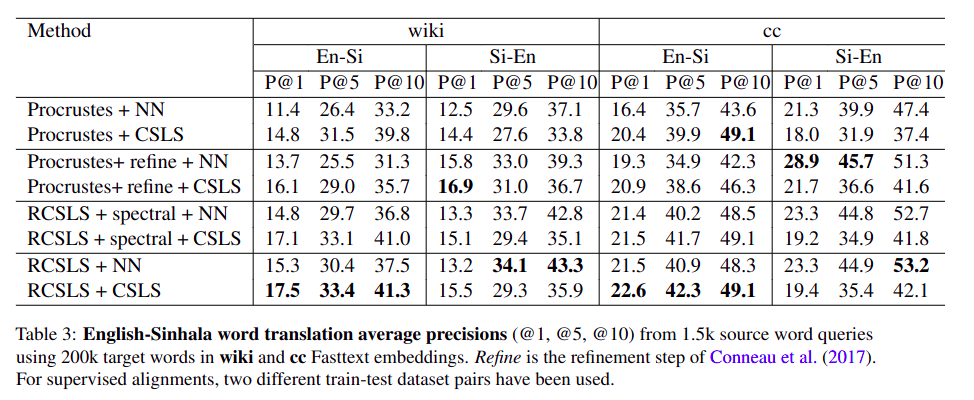
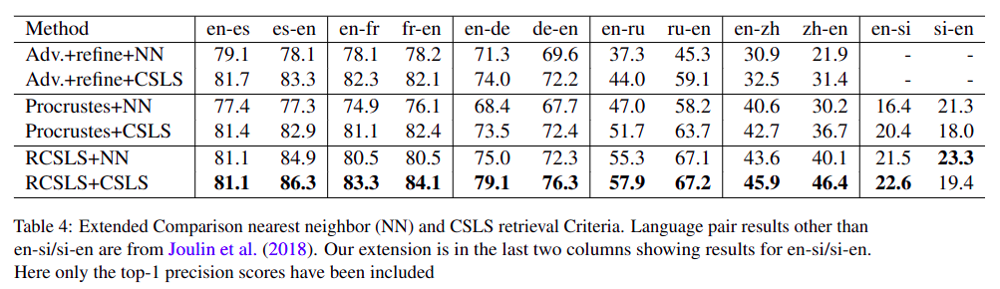
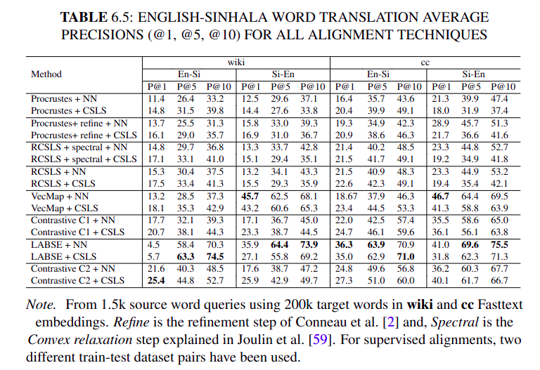
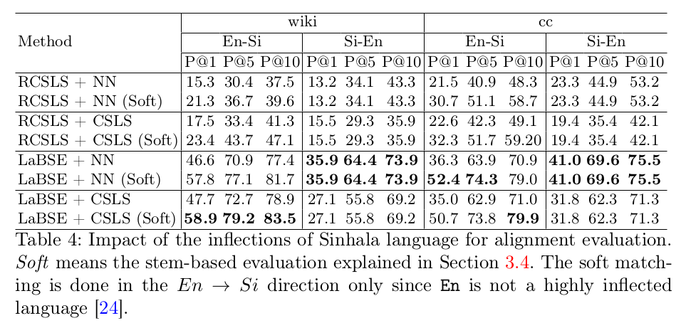
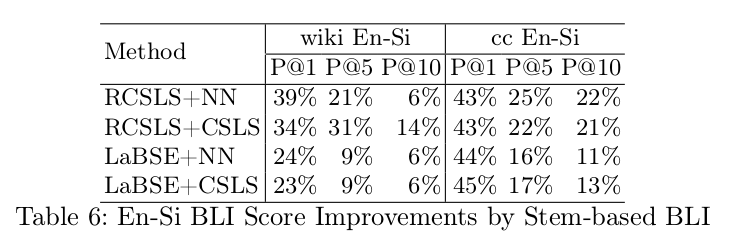
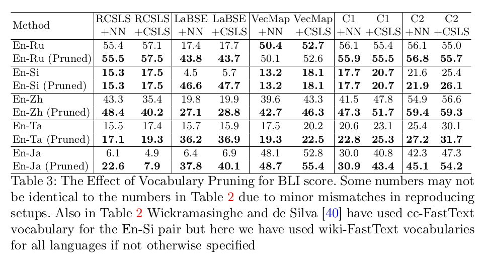
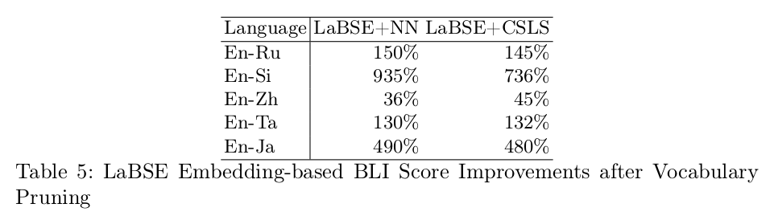

# Sinhala-English word-embedding Alignment

This repository contains the resources related to our research on English-Sinhala word embedding alignment.

- **alignment_matrices/** contains the alignment matrices obtained using different alignment techniques in different directions (i.e. Si --> En and En --> Si).
- **all_data/** contains all the datasets we used for the supervised alignment. The datasets have been created using the large datasets provided in [this](https://github.com/kasunw22/sinhala-para-dict/tree/main) repository.
- **muse_content/** contains the scripts used for ***iterative Procrustes*** alignment which have been adopted from [this](https://github.com/facebookresearch/MUSE/tree/main) repository by facebook-research.
- **rcsls_content/** contains the scripts used for ***RCSLS*** alignment which have been adopted from [the FastText](https://github.com/facebookresearch/fastText/tree/main/alignment) repository by facebook-research.
- **vecmap_content/** contains the scripts used for ***VecMap*** alignment which have been adopted from [the VecMap](https://github.com/artetxem/vecmap/tree/master) repository.
- **contrastive_bli_content/** contains the scripts used for ***ContranstiveBLI*** alignment which have been adopted from [the ContranstiveBLI](https://github.com/cambridgeltl/ContrastiveBLI/tree/main) repository.

## Results from the Papers

### Alignment results obtained for Sinhala-English alignment according to the paper:


### Comparison of Sinhala-English alignment with other language pairs according to the paper:


## Next Work

### Alignment results obtained for Sinhala-English alignment from further studies (publication is under review):


### Studies on BLI (under review):
#### Impact of Language Inflection on BLI



#### Impact of multilinguality on BLI



## Publications
If you are willing to use this work, please be kind enough to cite the following papers.

### [Dataset paper](https://arxiv.org/abs/2308.02234):

```
@INPROCEEDINGS{10253560,
  author={Wickramasinghe, Kasun and De Silva, Nisansa},
  booktitle={2023 IEEE 17th International Conference on Industrial and Information Systems (ICIIS)}, 
  title={Sinhala-English Parallel Word Dictionary Dataset}, 
  year={2023},
  volume={},
  number={},
  pages={61-66},
  keywords={Dictionaries;Annotations;Pipelines;Machine translation;Task analysis;Information systems;parallel corpus;alignment;English-Sinhala dictionary;word embedding alignment;lexicon induction},
  doi={10.1109/ICIIS58898.2023.10253560}}
```

### [Word Embedding Alignment paper](https://aclanthology.org/2023.paclic-1.42/): 
```
@inproceedings{wickramasinghe-de-silva-2023-sinhala,
    title = "{S}inhala-{E}nglish Word Embedding Alignment: Introducing Datasets and Benchmark for a Low Resource Language",
    author = "Wickramasinghe, Kasun  and
      de Silva, Nisansa",
    editor = "Huang, Chu-Ren  and
      Harada, Yasunari  and
      Kim, Jong-Bok  and
      Chen, Si  and
      Hsu, Yu-Yin  and
      Chersoni, Emmanuele  and
      A, Pranav  and
      Zeng, Winnie Huiheng  and
      Peng, Bo  and
      Li, Yuxi  and
      Li, Junlin",
    booktitle = "Proceedings of the 37th Pacific Asia Conference on Language, Information and Computation",
    month = dec,
    year = "2023",
    address = "Hong Kong, China",
    publisher = "Association for Computational Linguistics",
    url = "https://aclanthology.org/2023.paclic-1.42",
    pages = "424--435",
}
```

### [BLI paper](https://github.com/kasunw22/sinhala-word-embedding-alignment): 
```
@InProceedings{10.1007/978-3-032-10202-7_26,
author="Wickramasinghe, Kasun
and de Silva, Nisansa",
editor="Nguyen, Ngoc Thanh
and Dinh Duc Anh, Vu
and Kozierkiewicz, Adrianna
and Nguyen Van, Sinh
and Nunez, Manuel
and Treur, Jan
and Vossen, Gottfried",
title="How Good is BLI as an Alignment Measure: A Study in Word Embedding Paradigm",
booktitle="Advances in Computational Collective Intelligence",
year="2026",
publisher="Springer Nature Switzerland",
address="Cham",
pages="383--397",
abstract="Sans a dwindling number of monolingual embedding studies originating predominantly from the low-resource domains, it is evident that multilingual embedding has become the de facto choice due to its adaptability to the usage of code-mixed languages, granting the ability to process multilingual documents in a language-agnostic manner, as well as removing the difficult task of aligning monolingual embeddings. But is this victory complete? Are the multilingual models better than aligned monolingual models in every aspect? Can the higher computational cost of multilingual models always be justified? Or is there a compromise between the two extremes? Bilingual Lexicon Induction (BLI) is one of the most widely used metrics in terms of evaluating the degree of alignment between two embedding spaces. In this study, we explore the strengths and limitations of BLI as a measure to evaluate the degree of alignment of two embedding spaces. Further, we evaluate how well traditional embedding alignment techniques, novel multilingual models, and combined alignment techniques perform BLI tasks in the contexts of both high-resource and low-resource languages. In addition to that, we investigate the impact of the language families to which the pairs of languages belong. We identify that BLI does not measure the true degree of alignment in some cases and we propose solutions for them. We propose a novel stem-based BLI approach to evaluate two aligned embedding spaces that take into account the inflected nature of languages as opposed to the prevalent word-based BLI techniques. Further, we introduce a vocabulary pruning technique that is more informative in showing the degree of the alignment, especially performing BLI on multilingual embedding models. In addition to that, we find that in most cases, combined embedding alignment techniques that make use of both traditional alignment and multilingual embeddings perform better while for certain scenarios multilingual embeddings perform better (especially low-resource language cases). The traditional aligned embeddings lag behind the other two types of aligned embeddings in the majority of the cases.",
isbn="978-3-032-10202-7"
}
```
